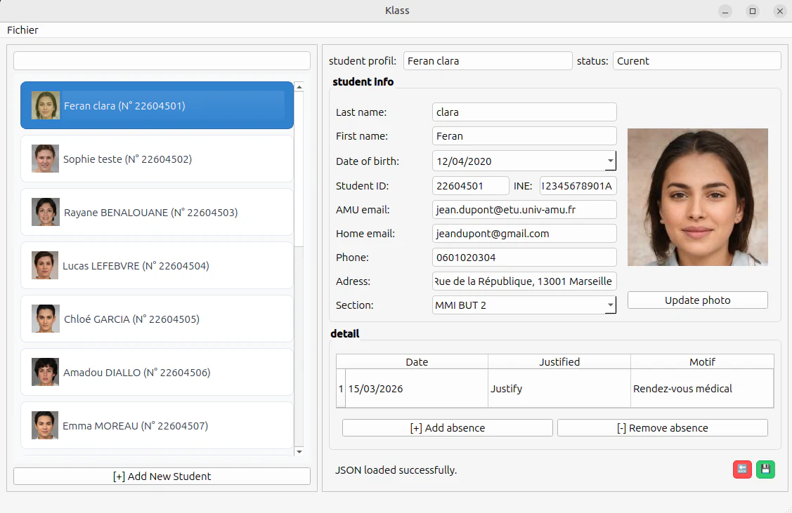
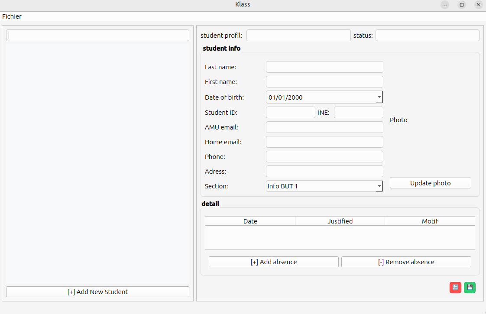
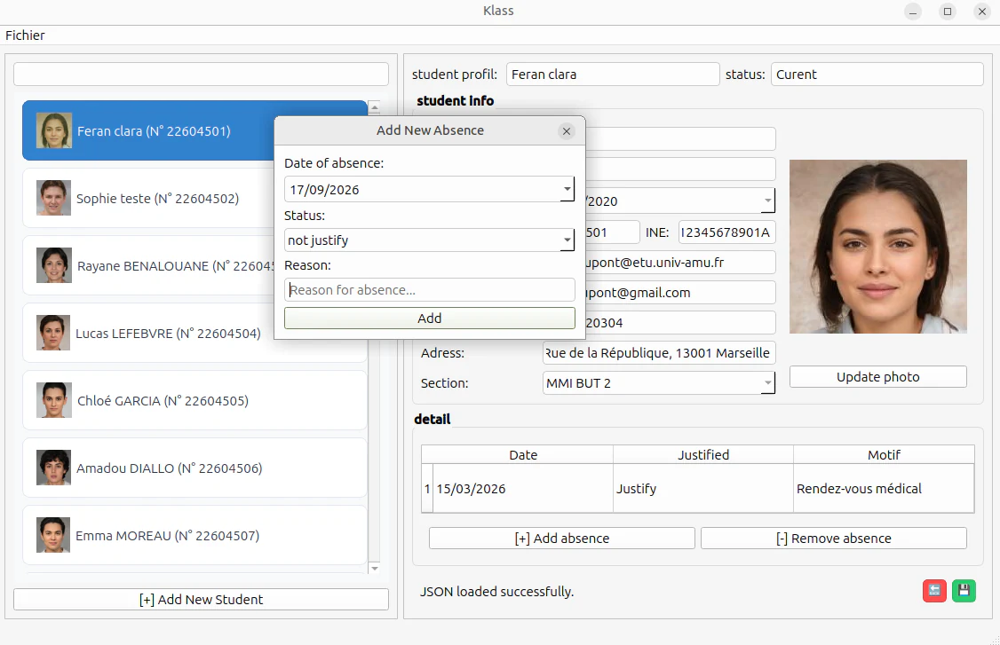

# Klass

Application de bureau de gestion d'étudiants, écrite en C++ avec Qt 6 : fiches
étudiants complètes, photos, suivi des absences, et des données enregistrées à la
fois en JSON et en XML, sans base de données.




## Contexte

SAE S2.01 du BUT Informatique (IUT d'Arles), réalisée en binôme par
**Pierre Puget** et **Julyan Klein** en mai-juin 2026.

## Fonctionnalités

- **Liste des étudiants** avec leur photo, et une recherche qui accepte du texte
  simple ou une expression régulière (insensible à la casse)
- **Fiche étudiant** : nom, prénom, date de naissance, numéro étudiant, numéro INE,
  téléphone, e-mails universitaire et personnel, adresse personnelle et adresse des
  parents, photo d'identité et section (BUT Info 1 à 3, BUT MMI 1 à 3)
- **Création et modification** : le numéro étudiant sert d'identifiant unique ;
  la fiche indique si l'étudiant vient d'être créé ou modifié
- **Absences** : ajout d'une absence (date, justifiée ou non, motif) et suppression
- **Deux formats synchronisés** : le jeu de données s'ouvre depuis le JSON ou le XML
  (menu Fichier), et chaque enregistrement réécrit les deux fichiers, qui restent
  donc identiques
- **Photos** : choisies depuis le disque, puis enregistrées dans `images/`
- **Bilingue** : interface en anglais, traduction française complète (Qt Linguist)
  activable depuis le menu

| Formulaire vide | Ajout d'une absence |
|---|---|
|  |  |

## Lancer le projet

Prérequis : Qt 6 (modules Widgets et XML) et Qt Creator.

1. Ouvrir `Klass.pro` dans Qt Creator, compiler puis lancer.
2. Dans l'application, menu Fichier : ouvrir `src/students_dataset.json` (ou
   `src/students_dataset.xml`).

Les photos sont retrouvées par rapport au fichier ouvert (`../images/`), il faut
donc garder les dossiers `src/` et `images/` côte à côte.

## Organisation du dépôt

```
Klass.pro            projet Qt
*.cpp / *.h          code source (Student, absence, DataStore, MainWindow)
mainwindow.ui        interface (Qt Designer)
Klass_fr_FR.ts       traduction française
src/                 jeu de données, lu et réécrit par l'application (JSON + XML)
images/              photos des étudiants (image_N.jpg) et photo par défaut
docs/                diagramme UML, feuille de temps, captures d'écran
```

Le code est découpé en trois classes métier et une fenêtre :

- `Student` : les données d'un étudiant et sa liste d'absences
- `absence` : une absence (date, justification, motif)
- `DataStore` : lecture et écriture JSON / XML, en méthodes statiques
- `MainWindow` : l'interface et la logique des boutons

## Données

Le jeu de données fourni est **entièrement fictif** (noms, adresses, numéros et
photos), il sert uniquement à faire tourner l'application.
